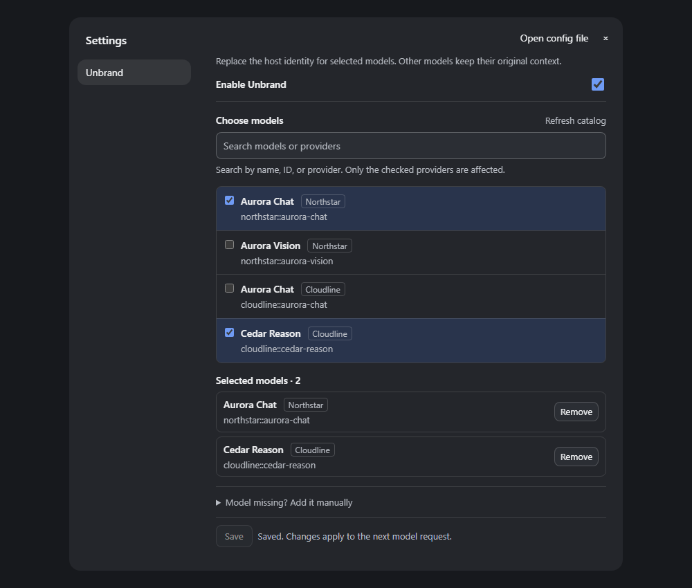

# Unbrand · 隐标

[中文](./README.md) · **English**

**Unbrand replaces the introduction DeepSeek Harness (DSH) sends to a model. You choose which models get the neutral wording.**

| Default prompt | With Unbrand |
| --- | --- |
| `You are an AI agent powered by DeepSeek Harness.` | `You are an AI assistant.` |

For those models, Unbrand also removes the source location and web interface address that DSH adds automatically. If you mention DSH in a conversation, the model still sees it. Your chat history, tools, and file permissions stay the same.

## Getting started

1. In **DSH Desktop 0.2.2-rc.1**, open **Plugins → Add plugin**, enter `dsh-unbrand@0.1.4`, and enable it. If prompted, quit and reopen DSH.
2. Open **Settings → Unbrand**, select a model, and click **Save**. No models are selected by default.
3. The next request uses the new wording, even in an existing chat. To restore the default prompt, turn Unbrand off and save.

*The model catalog shown here is an example.*

Only the desktop version above is supported. [Download the plugin](https://github.com/MaRi23333/dsh-unbrand/releases/tag/v0.1.4) · [Other ways to install and full usage guide](https://github.com/MaRi23333/dsh-unbrand/blob/main/docs/usage.en.md) · [MIT license](./LICENSE)
