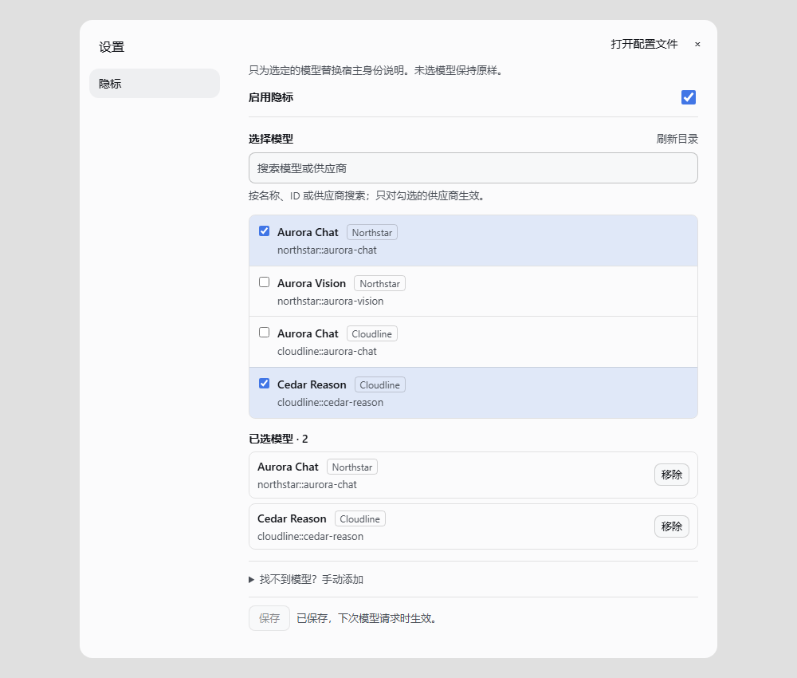

# 隐标 · Unbrand

**中文** · [English](./README.en.md)

**隐标有助于在 DeepSeek Harness（DSH）里接入第三方模型。** 勾选一个模型，就能把 DSH 发给它的默认启动词换成一句通用提示：

| DSH 默认启动词 | 选中的模型收到的启动词 |
| --- | --- |
| `You are an AI agent powered by DeepSeek Harness.` | `You are an AI assistant.` |

对选中的模型，隐标也会去掉 DSH 自动附上的源码位置和网页界面地址。你自己在对话里提到 DSH，模型仍会看到。聊天记录、工具和文件权限都不变。

0.1.6 根据宿主的来源记录识别运行上下文，并读取宿主正常组装的原厂身份段，为新措辞中的产品全名提供兜底。

## 下载安装

**0.1.5 起**以 DSH Desktop `0.2.2-rc.1` 为最低版本，不锁定后续版本。宿主升级后继续处理能确认来源的提示词；无法对齐的内容保留原文。

0.1.4 仍只适用于 rc.1。以下步骤安装 0.1.6。若 npm 暂未收录该版本，可直接使用下方的 GitHub Release 安装包。

1. 在左侧栏打开 **插件 → 添加插件**，输入 `dsh-unbrand@0.1.6`，或输入下方安装包的完整路径。
2. 安装完成后点 **立即启用**。如果提示重启，从应用菜单选 **退出（Quit）**，再重新打开 DSH。
3. 在 **设置 → 隐标** 看到插件入口，即已启用。

**手动下载安装包** [下载 dsh-unbrand-0.1.6.tgz](https://github.com/MaRi23333/dsh-unbrand/releases/download/v0.1.6/dsh-unbrand-0.1.6.tgz)，不用解压。在同一个「添加插件」框里输入下载文件的完整路径，再按上面的步骤启用。[查看 npm 包](https://www.npmjs.com/package/dsh-unbrand)

<details>
<summary>用桌面版命令行安装</summary>

先启动一次 DSH Desktop，在应用菜单选 **Manage dsh Command… → Install**，然后退出桌面版。打开新终端，运行：

```sh
dsh plugin --profile desktop add dsh-unbrand@0.1.6
dsh plugin --profile desktop list
```

看到 `dsh-unbrand@0.1.6` 后，重新打开桌面版并启用插件。请使用桌面版自带的 `dsh` 命令；通过 npm 或 `npx` 启动的独立 CLI 不能管理桌面插件。

</details>

## 怎么用

1. 在「设置 → 隐标」勾选你想使用通用启动词的模型，点「保存」。没勾选的模型照常使用默认启动词。
2. 从下一次请求起生效，不用新开会话。想恢复默认提示，关掉隐标并保存即可。



*图中的模型目录为示例。*

[其他安装方式和详细说明](https://github.com/MaRi23333/dsh-unbrand/blob/main/docs/usage.zh-CN.md) · [Apache-2.0 许可证](./LICENSE) · [第三方许可声明](./THIRD_PARTY_NOTICES.md)
